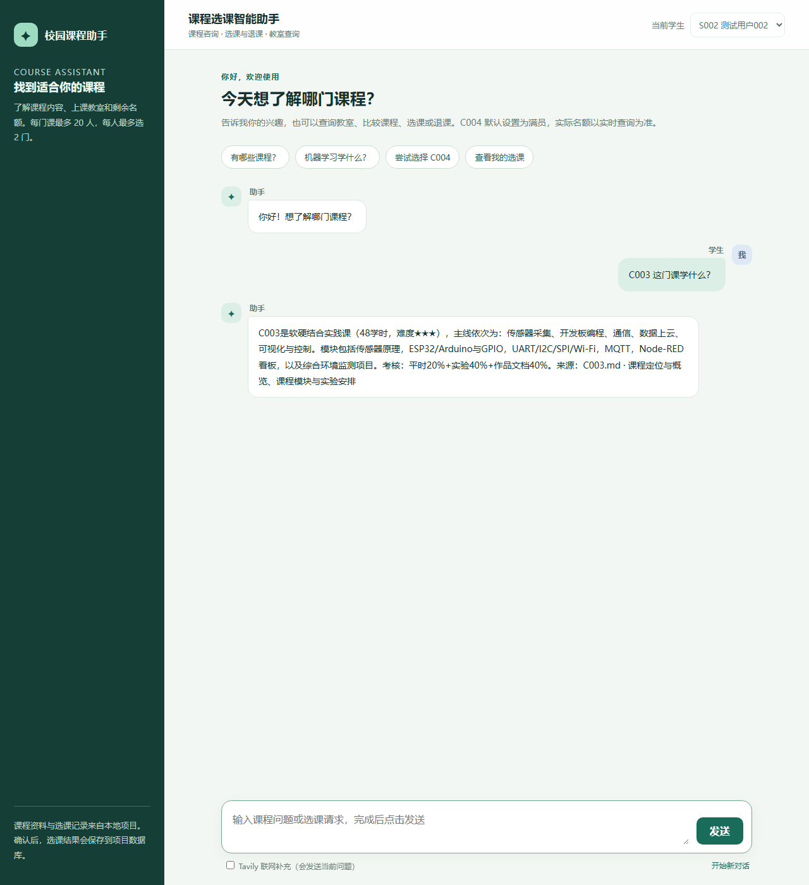
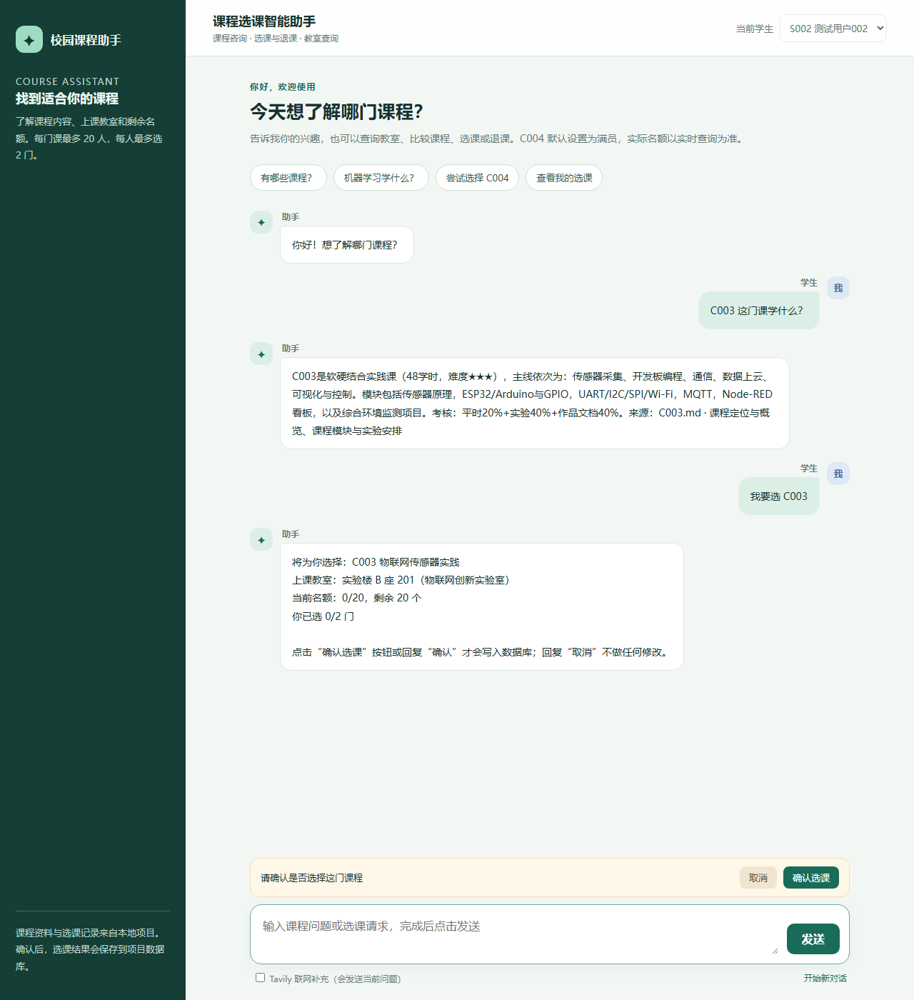
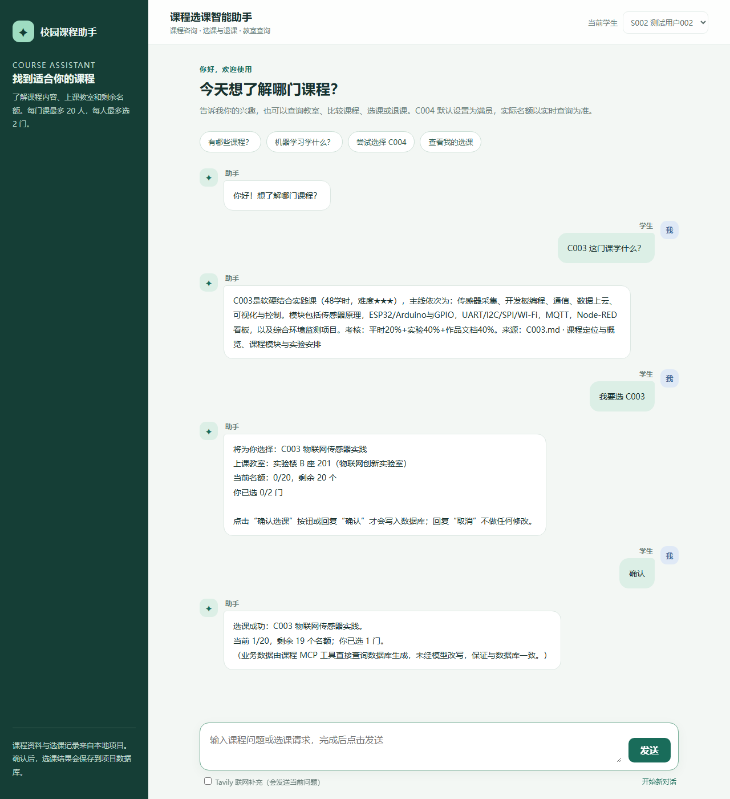

# 课程选课智能助手

基于 LangGraph + MCP + RAG 的课程咨询与选退课助手：先检索课程资料再回答并标注来源，选退课经用户确认后才写库。

本项目实现了一个可运行的课程咨询与选课助手：课程问答与追问、课程比较与推荐、目录 / 教室 / 实时名额查询，以及**经用户确认后**的选课与退课。技术栈覆盖 Model、Prompt、RAG、MCP、Skill、多 Agent 与 LangGraph，全部能力在本机实跑验证。

个人学习项目，用于把 Model / RAG / MCP / Skill / Agent / LangGraph 串成一条可运行链路；数据为虚构演示数据，不含真实师生信息。

## 功能与对应技术

| 功能 | 实现 | 技术 |
|---|---|---|
| 课程问答与追问 | 咨询 Agent 先检索课程资料再回答，标注来源；thread 记忆支持“这门课”式追问 | RAG + create_agent + InMemorySaver |
| 比较与推荐 | 逐门课检索，按方向/难度/先修/软硬件/适合人群比较，结合兴趣推荐 | 推荐 Skill + 分课程检索 + DeepSeek |
| 目录、教室、名额 | `list_courses` 聚合查询，实时人数与剩余名额 | 课程 MCP + SQLite |
| 我的选课 | `list_enrollments` 查询本人记录、教室与时间 | 课程 MCP + SQLite |
| 选课 / 退课 | 预检 → 确认（interrupt 暂停）→ 提交（事务写库）→ 返回真实名额 | LangGraph + 课程 MCP + 事务 |
| 外部参考 | 勾选联网时调用 Tavily，失败自动回退本地知识 | Tavily MCP（Streamable HTTP）+ REST 回退 |
| 异常与并发 | 满员 / 重复 / 个人上限 / 抢最后名额 | 条件路由 + BEGIN IMMEDIATE + 触发器 |

## 技术栈与实测口径

| 层 | 选型 |
|---|---|
| 运行时 | Python 3.12 |
| 框架 | FastAPI + Uvicorn（单进程，端口 8765） |
| 编排 | LangChain 1.x（`create_agent`）+ LangGraph 1.x（`plan → confirm → commit / reject` 状态机） |
| 工具协议 | MCP（stdio 子进程），4 个课程业务工具 |
| 检索 | `MarkdownHeaderTextSplitter` + `RecursiveCharacterTextSplitter`（chunk 420 / overlap 60）+ `InMemoryVectorStore` |
| 模型 | DeepSeek `deepseek-flash`（对话）、DashScope `text-embedding-v1`（向量，单批 10 条） |
| 数据 | SQLite（users / courses / enrollments，两个触发器兜底） |
| 可选 | Tavily MCP（勾选联网时启用，失败回退本地知识） |

实测口径（数字来自代码与数据文件，不估算）：

| 指标 | 数值 | 出处 |
|---|---|---|
| 知识库文件 / 检索片段 | 6 个 md / 45 个片段（8 / 8 / 9 / 8 / 8 / 4，平均 181.8 字） | `knowledge/courses` + `course_engine.py` 切分参数实跑 |
| MCP 工具 | 4 个（目录、我的选课、选课、退课） | `course_mcp_server.py` |
| 数据库触发器 | 2 个（`trg_course_capacity`、`trg_user_limit`） | `init_db.py` |
| 端到端测试场景 | 15 个 | `tests/test_cases.py` |
| 演示数据 | 23 用户 / 5 门课 / 20 条选课 | `data/course_selection.sqlite3` |

## 目录

```
app.py                       FastAPI 接口（/api/students、/api/sessions、/api/chat）与会话入口
course_engine.py             模型、Prompt、RAG、Skill、两个 Agent、MCP 客户端、LangGraph 工作流
course_mcp_server.py         课程业务 MCP Server（4 个工具，stdio 启动）
web_search.py                Tavily MCP 接入与失败回退
web/index.html               中文对话页面（输入、联网开关、确认/取消按钮）
knowledge/courses/           课程总览与 C001—C005 课程资料
data/course_selection.sqlite3  演示数据库（users / courses / enrollments）
data/course_selection.initial.sqlite3  初始备份（init_db.py 生成）
skills/course_recommendation/SKILL.md  课程推荐 Skill（触发条件、输入、步骤、输出）
init_db.py                   备份数据库并安装人数上限 / 个人上限触发器
tests/                       端到端测试、MCP 与并发测试、Prompt 对比、接口流程验证
scripts/                     架构图、图表与 Notebook 生成脚本
docs/images/                 页面截图（README 引用）
requirements.txt             运行依赖
requirements-dev.txt         Notebook 与图表用的可选依赖
reports/                     测试记录与图表，运行测试后生成（未随仓库提供）
课程选课智能助手.ipynb         实现与运行记录（已执行，含输出）
课程选课智能助手_框架.ipynb    课程提供的原始框架（未改动；实现以 .py 与实际运行记录为准）
```

## 启动方式

```bash
# 1. 虚拟环境（Python 3.12，Windows）
uv venv --python 3.12 .venv

# 2. 安装依赖（运行必需；跑 notebook / 生成图表再装 requirements-dev.txt）
VIRTUAL_ENV=.venv uv pip install -r requirements.txt
VIRTUAL_ENV=.venv uv pip install -r requirements-dev.txt   # 可选：notebook 与图表

# 3. 配置密钥：复制 .env.example 为 .env，填写 DEEPSEEK_API_KEY、DASHSCOPE_API_KEY
#    （TAVILY_API_KEY 可选，不填时联网补充会自动回退为本地知识回答）

# 4. 备份数据库并安装触发器（只做一次）
.venv\Scripts\python init_db.py

# 5. 启动服务，浏览器访问 http://127.0.0.1:8765
.venv\Scripts\python app.py
```

`macOS / Linux` 下把 `.venv\Scripts\python` 换成 `.venv/bin/python` 即可。修改 Python 代码后需要重启服务。

## 测试

```bash
.venv\Scripts\python tests\test_cases.py            # 端到端 15 个场景 → reports/test_results.md
.venv\Scripts\python tests\test_mcp_and_concurrency.py  # MCP 工具与并发抢名额 → reports/mcp_and_concurrency.md
.venv\Scripts\python tests\test_prompt_compare.py   # Prompt 优化前后对比 → reports/prompt_compare.md
.venv\Scripts\python tests\test_api_flow.py          # 通过 HTTP 接口走一遍选课确认流程
```

测试会写入并清理 S001—S003 的选课记录；如需恢复初始数据，执行 `python init_db.py --restore`。

## 关键实现说明

- **确认流程**：`plan` 节点做只读预检并生成确认话术，只有预检通过才进入 `confirm`；`confirm` 用
  `interrupt()` 暂停工作流，网页显示“确认 / 取消”，用户点击后 `chat()` 用 `Command(resume=...)` 恢复，
  `commit` 才调用 `select_course` / `drop_course`，`reject` 保证取消时数据库不变。
- **并发安全**：`select_course` 在 `BEGIN IMMEDIATE` 事务内重新统计人数与已选门数；数据库另有两个触发器
  （`trg_course_capacity`、`trg_user_limit`）兜底。并发测试中两人抢最后一个名额，只有一人成功，总数不超过 20。
- **数据边界**：课程内容只来自 `knowledge/courses`，教室 / 名额 / 选退课结果只来自 SQLite；
  业务类回复直接由工具结果格式化（不经模型复述数字），避免幻觉。
- **RAG**：Markdown 按标题 + 长度切分为 45 个片段（6 个知识库文件实跑，平均 181.8 字），`text-embedding-v1` 向量化（按文本哈希缓存到
  `data/embedding_cache.json`），`InMemoryVectorStore` 检索，支持按课程编号过滤。
- **会话记忆**：`InMemorySaver` + `thread_id=session_id` 保存状态与最近 6 轮对话，服务重启后清空；
  选课记录长期保存在 SQLite。

## 页面截图

| 课程问答（带来源） | 选课确认（写入前暂停） |
|---|---|
|  |  |

确认后写入数据库，名额从 20/20 变为 19/20：



## 验证记录（本机实跑）

环境：Python 3.12.12、依赖按 `requirements.txt` 安装（langchain 1.5.0）、服务监听 8765。

| 测试 | 命令 | 结果 |
|---|---|---|
| 端到端 15 个场景 | `tests/test_cases.py` | **15/15 通过**，报告 `reports/test_results.md` |
| MCP 工具与并发 | `tests/test_mcp_and_concurrency.py` | 4 个工具全部可调用；满员 `FULL`、重复 `DUPLICATE`、超个人上限 `USER_LIMIT`、未选退课 `NOT_ENROLLED` 均按预期拒绝；两人抢最后 1 个名额**成功人数 1、总人数 20** |
| Prompt 前后对比 | `tests/test_prompt_compare.py` | V1 对「每周要花多少时间」这类资料未收录的问题回答「课程资料中未提及」，V0 会展开推测 |
| 接口流程 | `tests/test_api_flow.py` | C004 满员被拒 → C001 进入确认 → 确认后写入（1/20）→ 我的选课显示 1/2 门 |

15 个场景覆盖：课程咨询、持续追问、比较与推荐、教室与名额、满员拒绝、取消不写库、确认后写库、重复选择、第 3 门超限、退课与名额释放、知识库无答案、Tavily 联网与回退、部署持久化、我的选课、满员后状态回归。

跑测试会写入并清理 S001—S003 的选课记录，需要恢复初始数据时执行 `.venv\Scripts\python init_db.py --restore`。

## 常见问题

- **启动后一说话就 500，日志出现「缺少 DEEPSEEK_API_KEY」**：`.env` 没配好。把 `.env.example` 复制成 `.env` 并填 `DEEPSEEK_API_KEY`（对话）与 `DASHSCOPE_API_KEY`（`text-embedding-v1` 向量化），改完必须重启服务。
- **导入或检索时报 `cosine_similarity requires numpy`**：`InMemoryVectorStore` 依赖 numpy，`requirements.txt` 已显式列出，装完依赖即可。
- **8765 被占用**：`app.py` 末尾的 `uvicorn.run(..., port=8765)` 改端口，同时改 `web/index.html` 里请求的地址。
- **向量每次重启重建**：向量索引在内存里，`data/embedding_cache.json` 只缓存文本向量；删掉该文件会全量重算。

## 已知限制

- 演示身份（S001—S003）未接入真实教务认证，请勿用于真实环境。
- 未实现排课时间冲突检查、邮件通知；会话记忆与向量索引都在内存中，重启后需要重建（向量有磁盘缓存）。
- 未配置 `TAVILY_API_KEY` 时只能使用本地知识库，联网回退路径已测试，真实搜索未纳入自动化测试。
- 本项目未附带任何真实 API Key；`.env` 已在 `.gitignore` 中。
